# Resumen del análisis exploratorio

Generado automáticamente por `src/exploration.py` (o por `notebooks/01_eda.ipynb`). Se reemplaza en cada ejecución.

## Fuentes

| carpeta | archivos | tamaño_MB | filas |
|---|---|---|---|
| adjudicaciones | 5 | 69.2 | 317485 |
| ampliaciones | 5 | 5.6 | 30789 |
| arbitraje | 5 | 0.2 | 631 |
| contratos | 5 | 9.4 | 42578 |
| convocatorias | 5 | 71.0 | 315745 |
| entidades_contratantes | 1 | 0.4 | 3366 |
| ofertantes | 5 | 42.0 | 1008414 |
| penalidades | 1 | 2.6 | 14963 |
| rnp | 1 | 20.3 | 18008 |
| sancionados | 1 | 3.2 | 9831 |

Tabla: [`tables/fuentes.csv`](tables/fuentes.csv)

## Diccionario de datos raw

Columnas de cada fuente tal como se leen (encabezados en minúscula en las fuentes del SEACE) y cuáles usa el preprocesamiento:

| fuente | columnas | usadas |
|---|---|---|
| convocatorias | 28 | 3 |
| adjudicaciones | 25 | 13 |
| ofertantes | 6 | 5 |
| contratos | 24 | 4 |
| ampliaciones | 17 | 3 |
| arbitraje | 34 | 0 |
| penalidades | 8 | 4 |
| sancionados | 8 | 5 |
| rnp (inhabilitaciones) | 11 | 5 |
| rnp (multas) | 14 | 4 |
| entidades_contratantes | 9 | 0 |

Ver diccionario completo (184 columnas)

| fuente | columna | %_nulos | valores_distintos | ejemplo | constante | se_usa | uso_en_el_preprocesamiento |
|---|---|---|---|---|---|---|---|
| convocatorias | codigoentidad | 0.0 | 3049 | 001666 | False | no |  |
| convocatorias | entidad_ruc | 0.0 | 3049 | 20200712146 | False | no |  |
| convocatorias | entidad | 0.0 | 3048 | MUNICIPALIDAD DISTRITAL DE ASILLO | False | no |  |
| convocatorias | tipoentidad | 0.0 | 5 | GOBIERNO LOCAL | False | no |  |
| convocatorias | codigoconvocatoria | 0.0 | 281809 | 778943 | False | sí | llave del ítem |
| convocatorias | descripcion_proceso | 0.0 | 269302 | ADQUISICION DE CALAMINA GALVANIZADA COLOR ROJ | False | no |  |
| convocatorias | proceso | 0.0 | 255886 | AS-SM-1-2022-MDA//OEC-1 | False | no |  |
| convocatorias | tipocompra | 0.0 | 3 | Por la Entidad | False | no |  |
| convocatorias | objetocontractual | 0.0 | 4 | Bien | False | no |  |
| convocatorias | sector / nivel de gobierno | 0.0 | 24 | GOBIERNO LOCAL | False | sí | sector de la entidad |
| convocatorias | sistema_contratacion | 0.0 | 10 | Suma alzada | False | no |  |
| convocatorias | tipoprocesoseleccion | 0.0 | 42 | Adjudicación Simplificada | False | no |  |
| convocatorias | montoreferencial | 0.0 | 189967 | 167960.00 | False | no |  |
| convocatorias | n_item | 0.0 | 714 | 1 | False | sí | llave del ítem |
| convocatorias | descripcion_item | 0.0 | 272405 | ADQUISICION DE CALAMINA GALVANIZADA COLOR ROJ | False | no |  |
| convocatorias | unidad_medida | 0.0 | 27 | Unidad | False | no |  |
| convocatorias | estadoitem | 0.0 | 3 | Contratado | False | no |  |
| convocatorias | paquete | 0.0 | 2 | NO | False | no |  |
| convocatorias | codigoitem | 16.1 | 21348 | 00147446 | False | no |  |
| convocatorias | itemcubso | 16.1 | 21358 | CUMBRERA PARA CALAMINA GALVANIZADA DE 0.50 m  | False | no |  |
| convocatorias | monto_referencial_item | 0.0 | 207098 | 167960 | False | no |  |
| convocatorias | moneda | 0.0 | 8 | Soles | False | no |  |
| convocatorias | departamento_item | 0.4 | 27 | PUNO | False | no |  |
| convocatorias | provincia_item | 0.4 | 198 | AZANGARO | False | no |  |
| convocatorias | distrito_item | 0.4 | 1735 | ASILLO | False | no |  |
| convocatorias | fecha_convocatoria | 0.0 | 1293 | 2022-02-16 | False | no |  |
| convocatorias | fechaintegracionbases | 38.7 | 1183 | 2022-02-21 | False | no |  |
| convocatorias | fechapresentacionpropuesta | 11.7 | 1194 | 2022-02-24 | False | no |  |
| adjudicaciones | codigoentidad | 0.0 | 3049 | 204387 | False | sí | diversificación por entidad |
| adjudicaciones | entidad_ruc | 0.0 | 3049 | 20604676372 | False | no |  |
| adjudicaciones | entidad | 0.0 | 3048 | PROGRAMA NACIONAL DE TELECOMUNICACIONES | False | no |  |
| adjudicaciones | tipoentidad | 0.0 | 5 | GOBIERNO NACIONAL | False | sí | composición por tipo de entidad |
| adjudicaciones | entidad_departamento | 0.0 | 25 | LIMA | False | sí | departamento si falta el del ítem |
| adjudicaciones | codigoconvocatoria | 0.0 | 281809 | 880908 | False | sí | llave del ítem |
| adjudicaciones | objetocontractual | 0.0 | 4 | Servicio | False | sí | composición por objeto |
| adjudicaciones | tipoprocesoseleccion | 0.0 | 42 | Convenio | False | sí | familia de proceso |
| adjudicaciones | proceso | 0.0 | 255886 | CONV-PROC-13-2022-MTC/24-BIRF-1 | False | no |  |
| adjudicaciones | descripcion_proceso | 0.0 | 269302 | Servicio de Consultoría Individual para reali | False | no |  |
| adjudicaciones | n_item | 0.0 | 714 | 1 | False | sí | llave del ítem |
| adjudicaciones | descripcion_item | 0.0 | 272405 | Servicio de Consultoría Individual para reali | False | no |  |
| adjudicaciones | estado_item | 0.0 | 3 | Contratado | False | no |  |
| adjudicaciones | cantidad_adjudicado_item | 0.0 | 29317 | 1 | False | no |  |
| adjudicaciones | monto_referencial_item_soles | 0.0 | 209232 | 63000 | False | sí | ratio adjudicado / referencial |
| adjudicaciones | monto_adjudicado_item_soles | 0.0 | 184860 | 63000 | False | sí | montos |
| adjudicaciones | departamento_item | 0.4 | 27 | LIMA | False | sí | diversificación por departamento |
| adjudicaciones | moneda | 0.0 | 8 | Soles | False | no |  |
| adjudicaciones | unidad_medida | 0.0 | 27 | Servicio | False | no |  |
| adjudicaciones | ruc proveedor | 0.0 | 121526 | 15384298921 | False | sí | identificador del proveedor |
| adjudicaciones | proveedor | 0.0 | 94363 | SAAVEDRA MENDOZA WILMER | False | no |  |
| adjudicaciones | tipo_proveedor | 0.0 | 4 | Persona Natural | False | sí | población y tipo de contribuyente |
| adjudicaciones | fecha_convocatoria | 0.0 | 1293 | 11/11/2022 | False | no |  |
| adjudicaciones | fecha_buenapro | 0.0 | 1572 | 16/02/2023 | False | sí | fecha en que se conoce el ítem |
| adjudicaciones | fecha_consentimiento_bp | 1.7 | 1702 | 16/02/2023 | False | no |  |
| ofertantes | codigo_convocatoria | 0.0 | 280858 | 789934 | False | sí | llave del ítem |
| ofertantes | fechaconvocatoria | 0.0 | 29348 | 2022-03-24 00:00:00 | False | sí | fecha de la oferta si la propuesta tiene fecha imposible |
| ofertantes | n_item | 0.0 | 716 | 1 | False | sí | llave del ítem |
| ofertantes | ruc_codigo_postor | 0.0 | 250406 | 20608480898 | False | sí | identificador del postor |
| ofertantes | postor | 0.0 | 150750 | INVERSIONES GENERALES Y ESTACION DE SERVICIOS | False | no |  |
| ofertantes | fecha_presentacion_propuesta | 0.0 | 1768 | 2022-03-27 | False | sí | fecha de la oferta |
| contratos | codigoentidad | 0.0 | 2145 | 010520 | False | no |  |
| contratos | codigoconvocatoria | 0.0 | 26640 | 858558 | False | no |  |
| contratos | descripcion_proceso | 0.0 | 26175 | CONTRATACION PARA LA EJECUCION DE LA OBRA: "M | False | no |  |
| contratos | n_cod_contrato | 0.0 | 28527 | 2166442 | False | sí | llave del contrato (para ampliaciones) |
| contratos | codigo_contrato | 0.0 | 28527 | 2166442 | False | no |  |
| contratos | num_contrato | 0.0 | 24674 | CONTRATO DE EJECUCION DE OBRA N° 006-2022-GR. | False | no |  |
| contratos | num_item | 0.0 | 182 | 1 | False | sí | llave del contrato-ítem |
| contratos | monto_contratado_total | 0.0 | 24855 | 4750000.36 | False | no |  |
| contratos | monto_contratado_item | 0.0 | 26122 | 4750000.36 | False | no |  |
| contratos | monto_adicional | 0.0 | 26000 | 228710.47 | False | no |  |
| contratos | monto_reduccion | 0.0 | 10617 | 0 | False | no |  |
| contratos | monto_prorroga | 0.0 | 717 | 0 | False | no |  |
| contratos | monto_complementario | 0.0 | 1 | 0 | True | no |  |
| contratos | moneda | 0.0 | 5 | Soles | False | no |  |
| contratos | ruc_contratista | 0.0 | 18320 | 547530 | False | sí | proveedor del contrato |
| contratos | ruc_destinatario_pago | 0.0 | 15462 | 20610381392 | False | sí | identifica consorcios |
| contratos | tieneresolucion | 98.8 | 1 | SI | True | no |  |
| contratos | urlcontrato | 0.0 | 28524 | https://prodapp2.seace.gob.pe/portalseace-uiw | False | no |  |
| contratos | espublicado | 0.0 | 1 | 1 | True | no |  |
| contratos | fecha_publicacion_contrato | 0.0 | 1363 | 2022-12-29 | False | no |  |
| contratos | fecha_suscripcion_contrato | 0.0 | 1286 | 2022-12-29 | False | no |  |
| contratos | fecha_vigencia_inicial | 0.0 | 1653 | 2022-12-30 | False | no |  |
| contratos | fecha_vigencia_final | 0.0 | 2168 | 2023-05-29 | False | no |  |
| contratos | fecha_vigencia_fin_actualizada | 0.0 | 2181 | 2023-11-16 | False | no |  |
| ampliaciones | codigocontrato | 0.0 | 16690 | 2105638 | False | sí | llave del contrato |
| ampliaciones | descripcion_objeto | 0.0 | 15818 | CONTRATACIÓN DE LA EJECUCIÓN DE LA OBRA: ¿MEJ | False | no |  |
| ampliaciones | num_contrato | 0.0 | 15164 | 022-2022/GRJ/ORAF | False | no |  |
| ampliaciones | fecha_modificacion_contrato | 0.0 | 1274 | 23/03/2022 | False | no |  |
| ampliaciones | fecha_creacion_ampliacion | 0.0 | 1251 | 22/10/2024 | False | no |  |
| ampliaciones | fecha_publicacion_ampliacion | 0.0 | 1251 | 22/10/2024 | False | sí | fecha de la ampliación |
| ampliaciones | fecha_vigencia_inicio | 0.0 | 2070 | 08/07/2024 | False | no |  |
| ampliaciones | fecha_vigencia_fin | 0.0 | 2108 | 05/10/2024 | False | no |  |
| ampliaciones | fecha_vigencia_fin_actual | 0.0 | 2069 | 07/07/2024 | False | no |  |
| ampliaciones | plazo | 0.0 | 708 | 90 | False | no |  |
| ampliaciones | descripcion_ampliacion | 0.0 | 21100 | Ampliacion de Plazo N° 12 | False | no |  |
| ampliaciones | tipo_documento_sustento | 0.0 | 7 | Resolución | False | no |  |
| ampliaciones | numero_documento | 0.0 | 23081 | 561-2024 | False | sí | quitar duplicados |
| ampliaciones | nombre_documento | 0.0 | 28197 | 09. RESOLUCION DE AMPLIACION DE PLAZO N° 12.p | False | no |  |
| ampliaciones | url_documento | 0.0 | 30788 | https://prod4.seace.gob.pe:9000/api/con/docum | False | no |  |
| ampliaciones | norma_aplicable | 0.0 | 12 | OTROS REGIMENES | False | no |  |
| ampliaciones | sistema_origen | 0.0 | 1 | SEACE_V3 | True | no |  |
| arbitraje | codigoconvocatoria | 0.0 | 476 | 794435 | False | no |  |
| arbitraje | n_cod_contrato | 0.0 | 490 | 2122512 | False | no |  |
| arbitraje | num_contrato | 0.0 | 486 | CONTRATO Nº 0015-2022-SENASA | False | no |  |
| arbitraje | descripcion_proceso | 0.0 | 474 | SERVICIO DE INTERCONEXION DE LA RED NACIONAL  | False | no |  |
| arbitraje | objetocontractual | 0.0 | 4 | Servicio | False | no |  |
| arbitraje | proceso | 0.0 | 473 | CP-SM-1-2022-SENASA-1 | False | no |  |
| arbitraje | codigoentidad | 0.0 | 243 | 001995 | False | no |  |
| arbitraje | entidad | 0.0 | 243 | SERVICIO NACIONAL DE SANIDAD AGRARIA | False | no |  |
| arbitraje | num_item | 0.0 | 48 | 1 | False | no |  |
| arbitraje | departamento_item | 5.4 | 26 | LIMA | False | no |  |
| arbitraje | provincia_item | 5.4 | 122 | LIMA | False | no |  |
| arbitraje | distrito_item | 5.4 | 255 | LA MOLINA | False | no |  |
| arbitraje | descripcion_item | 0.0 | 539 | SERVICIO DE INTERCONEXION DE LA RED NACIONAL  | False | no |  |
| arbitraje | monto_contratado_item | 0.0 | 540 | 1111111.11 | False | no |  |
| arbitraje | moneda | 0.0 | 1 | Soles | True | no |  |
| arbitraje | tieneresolucion | 85.6 | 1 | SI | True | no |  |
| arbitraje | tipodemandante | 0.0 | 3 | Contratista | False | no |  |
| arbitraje | tipoarbitraje | 0.0 | 2 | Institucional | False | no |  |
| arbitraje | tipoarbitro | 0.0 | 2 | Tribunal Arbitral | False | no |  |
| arbitraje | nombrepresidente | 0.2 | 253 | QUINTANA SANCHEZ JUAN ALBERTO | False | no |  |
| arbitraje | rucarbitroentidad | 76.5 | 77 | 10079026749 | False | no |  |
| arbitraje | nombrearbitroentidad | 76.5 | 77 | EGUIGUREN PRAELI AUGUSTO ENRIQUE | False | no |  |
| arbitraje | rucarbitrocontratista | 76.5 | 104 | 10096724212 | False | no |  |
| arbitraje | nombrearbitrocontratista | 76.5 | 104 | SAN ROMAN ALVA ARMANDO HERNAN | False | no |  |
| arbitraje | fecha_convocatoria | 0.0 | 328 | 03/03/2022 | False | no |  |
| arbitraje | fecha_publicacion_contrato | 0.0 | 336 | 17/06/2022 | False | no |  |
| arbitraje | fecha_suscripcion_contrato | 0.0 | 363 | 25/05/2022 | False | no |  |
| arbitraje | fecha_vigencia_inicial | 0.0 | 380 | 26/09/2022 | False | no |  |
| arbitraje | fecha_vigencia_fin_actualizada | 0.0 | 393 | 09/08/2025 | False | no |  |
| arbitraje | fecha_instalacion | 0.0 | 397 | 31/08/2023 | False | no |  |
| arbitraje | fecha_emision_laudo | 74.3 | 116 | 13/09/2024 | False | no |  |
| arbitraje | fecha_inicio_proceso_arbitral | 74.3 | 121 | 22/02/2023 | False | no |  |
| arbitraje | fecha_documento_laudo | 74.3 | 118 | 11/10/2024 | False | no |  |
| arbitraje | fecha_registro_laudo_seace | 74.3 | 121 | 11/10/2024 | False | no |  |
| penalidades | id_contrato | 0.0 | 5448 | 2255476 | False | no |  |
| penalidades | ruc_contratista | 0.0 | 3420 | 20536426168 | False | sí | identificador del proveedor |
| penalidades | tipo_penalidad | 0.0 | 2 | Otra Penalidad | False | sí | penalidades por mora |
| penalidades | objeto_contrato | 0.0 | 4 | Servicio | False | no |  |
| penalidades | entidad | 0.0 | 670 | PROYECTO ESPECIAL DE INVERSION PUBLICA ESCUEL | False | no |  |
| penalidades | fecha_penalidad | 0.0 | 1652 | 2026-03-10 00:00:00 | False | sí | fecha de la penalidad |
| penalidades | motivo | 0.0 | 9127 | PENALIDAD POR INCIDENCIA ADMINISTRATIVA ASOCI | False | no |  |
| penalidades | monto | 0.0 | 8427 | 220.0 | False | sí | monto de penalidades |
| sancionados | FECHA_CORTE | 0.0 | 1 | 20261114 | True | no |  |
| sancionados | RUC | 0.0 | 6237 | 20100994128 | False | sí | identificador del proveedor |
| sancionados | NOMBRE_RAZONODENOMINACIONSOCIAL | 0.0 | 6416 | CONSTRUCTORA DOS DE MAYO S.A. | False | no |  |
| sancionados | FECHA_INICIO | 0.0 | 2072 | 19980806 | False | sí | fecha del evento |
| sancionados | FECHA_FIN | 11.3 | 2034 | 20260804 | False | sí | vigencia e inhabilitación indefinida |
| sancionados | NUMERO_RESOLUCION | 0.0 | 8723 | 074-1998-TL | False | sí | unir con el RNP sin repetir |
| sancionados | ID_MOTIVO_INFRACCION | 0.0 | 143 | 12 | False | no |  |
| sancionados | DE_MOTIVO_INFRACCION | 0.0 | 120 | RESCISION ADMINISTRATIVA DEL CONTRATO | False | sí | grupo de motivo |
| rnp (inhabilitaciones) | numero | 0.0 | 11320 | 1 | False | no |  |
| rnp (inhabilitaciones) | razon_social | 0.0 | 7358 | CHALCO SULCA CARMELA | False | no |  |
| rnp (inhabilitaciones) | ruc | 0.0 | 7135 | 10408572661 | False | sí | identificador del proveedor |
| rnp (inhabilitaciones) | resolucion | 0.0 | 9893 | 8561-2026-TCP-S1 | False | sí | unir con CONOSCE sin repetir |
| rnp (inhabilitaciones) | periodo | 0.0 | 64 | DEFINITIVO | False | no |  |
| rnp (inhabilitaciones) | desde | 0.0 | 2254 | 06/10/2026 | False | sí | fecha del evento |
| rnp (inhabilitaciones) | hasta | 0.0 | 2387 |  | False | sí | vigencia e inhabilitación indefinida |
| rnp (inhabilitaciones) | infraccion | 0.0 | 122 | - l) Presentar información inexacta a las ent | False | sí | grupo de motivo |
| rnp (inhabilitaciones) | otra_infraccion | 0.0 | 21 |  | False | no |  |
| rnp (inhabilitaciones) | norma | 0.0 | 12 | Ley Nº 32069 | False | no |  |
| rnp (inhabilitaciones) | estado | 0.0 | 2 | VIGENTE | False | no |  |
| rnp (multas) | numero | 0.0 | 6688 | 1 | False | no |  |
| rnp (multas) | razon_social | 0.0 | 4775 | SERVICIOS E INNOVACIONES CK S.A.C. - SEICK S. | False | no |  |
| rnp (multas) | ruc | 0.0 | 4718 | 20606824344 | False | sí | identificador del proveedor |
| rnp (multas) | resolucion | 0.0 | 6210 | 8659-2026-TCP-S5 | False | sí | llave de la multa |
| rnp (multas) | fecha_resolucion | 0.0 | 1176 | 14/09/2026 | False | sí | fecha del evento |
| rnp (multas) | monto_multa | 0.0 | 1335 | 428167.24 | False | no |  |
| rnp (multas) | infraccion | 0.0 | 23 | - b) Incumplir injustificadamente con su obli | False | sí | grupo de motivo |
| rnp (multas) | periodo_suspension | 0.0 | 14 | 4 MESES | False | no |  |
| rnp (multas) | desde | 0.0 | 1110 | 7/10/2026 | False | no |  |
| rnp (multas) | hasta | 0.0 | 1297 | 07/02/2027 | False | no |  |
| rnp (multas) | otra_infraccion | 0.0 | 1 |  | True | no |  |
| rnp (multas) | norma | 0.0 | 6 | TUO de la Ley N° 30225 - D.S N° 082-2019-E.F | False | no |  |
| rnp (multas) | verificacion_pago | 0.0 | 736 |  | False | no |  |
| rnp (multas) | estado | 0.0 | 2 | VIGENTE | False | no |  |
| entidades_contratantes | RUC | 0.0 | 3366 | 20290898685 | False | no |  |
| entidades_contratantes | NOMBRE_DE_ENTIDAD | 0.0 | 3365 | ACADEMIA DE LA MAGISTRATURA | False | no |  |
| entidades_contratantes | DEPARTAMENTO | 0.0 | 25 | LIMA | False | no |  |
| entidades_contratantes | PROVINCIA | 0.0 | 196 | LIMA | False | no |  |
| entidades_contratantes | DISTRITO | 0.0 | 1725 | JESUS MARIA | False | no |  |
| entidades_contratantes | CODIGO_SIAF | 10.4 | 3014 | 0014 | False | no |  |
| entidades_contratantes | CODCONSUCODE | 0.0 | 3366 | 1940 | False | no |  |
| entidades_contratantes | ESTADO | 0.0 | 2 | Activo | False | no |  |
| entidades_contratantes | ULTIMAACTUALIZACION | 0.0 | 462 | 17/07/13 | False | no |  |

Tabla: [`tables/diccionario_de_datos_raw.csv`](tables/diccionario_de_datos_raw.csv)

## Hallazgos por fuente

- Convocatorias: 315,745 ítems de convocatoria (2022-2026), todos adjudicados; 42 tipos de proceso con variantes.
- Adjudicaciones: 315,745 ítems con su ganador; cubren el 100% de las convocatorias. Ganadores: Persona Juridica 62%, Consorcio 20%, Persona Natural 16%, Persona No Domiciliada 3%.
- Ofertantes: 1,008,193 ofertas; el 99.4% de los ítems adjudicados tiene postores y el ganador figura entre ellos en el 99.1%. El 38% de los ítems tuvo un solo postor.
- Contratos: solo el 9.4% de los ítems adjudicados tiene contrato en el archivo; cada fila extra de un contrato es una modificación sin fecha.
- Penalidades: 14,963 registros con fecha y RUC (275 duplicados, 4 líneas mal formadas reparadas).
- Ampliaciones: 30,789 registros con fecha pero sin RUC; solo el 57% corresponde a contratos del archivo.
- Arbitraje: solo 631 registros; no se usa.
- Sanciones: 18,058 eventos únicos (11,374 inhabilitaciones y 6,684 multas) al unir RNP y CONOSCE. Las listas solo incluyen sanciones que terminaron después del 2021-10-11 (consulta de los últimos 5 años del RNP). Fecha de extracción más temprana: 2026-10-11.

## Cruces entre fuentes

| desde | hacia | llave | % con pareja |
|---|---|---|---|
| convocatoria-ítem | adjudicación | codigoconvocatoria + n_item | 100.0 |
| adjudicación | ofertantes | codigoconvocatoria + n_item | 99.4 |
| adjudicación | contrato | codigoconvocatoria + n_item / num_item | 9.41 |
| contrato-ítem | adjudicación | codigoconvocatoria + num_item / n_item | 100.0 |
| ampliación | contrato | codigocontrato = n_cod_contrato | 57.38 |
| arbitraje | contrato | n_cod_contrato | 96.2 |
| penalidad | contrato | id_contrato = n_cod_contrato | 20.36 |
| penalidad | proveedor adjudicado | ruc_contratista = ruc_proveedor | 86.55 |
| adjudicación | entidad | codigoentidad (sin ceros) | 99.77 |
| proveedor adjudicado (RUC) | alguna sanción | RUC | 6.13 |
| proveedor adjudicado (RUC) | alguna penalidad | RUC | 5.0 |

Tabla: [`tables/cruces_entre_fuentes.csv`](tables/cruces_entre_fuentes.csv)

## Consorcios y no domiciliados

Solo tienen código, no RUC, así que no aparecen en las listas de sanciones:

| tipo_proveedor | proveedores | pct_sancionado |
|---|---|---|
| Consorcio | 62013 | 0.0 |
| Persona Juridica | 33444 | 8.42 |
| Persona Natural | 21738 | 2.59 |
| Persona No Domiciliada | 4329 | 0.05 |

## Primer vistazo al objetivo

Ítems adjudicados a personas naturales y jurídicas con la ventana de 12 meses completa: 190,727. Tasa de sanción del proveedor en los 12 meses siguientes a la buena pro: 3.96%.

| grupo | categoría | items | % sancionado en 12 meses |
|---|---|---|---|
| tipo_proveedor | Persona Juridica | 152383 | 4.55 |
| tipo_proveedor | Persona Natural | 38344 | 1.62 |
| familia_proceso | Adjudicación simplificada | 84431 | 3.4 |
| familia_proceso | Comparación de precios | 16247 | 1.42 |
| familia_proceso | Concurso público | 10825 | 6.75 |
| familia_proceso | Contratación directa | 17731 | 2.78 |
| familia_proceso | Licitación pública | 14684 | 3.47 |
| familia_proceso | Otros | 15122 | 1.72 |
| familia_proceso | Subasta inversa | 31687 | 7.77 |
| tipoentidad | FONAFE | 12816 | 5.13 |
| tipoentidad | GOBIERNO LOCAL | 69133 | 3.52 |
| tipoentidad | GOBIERNO NACIONAL | 65228 | 4.38 |
| tipoentidad | GOBIERNO REGIONAL | 41015 | 3.82 |
| tipoentidad | PETROPERU | 2535 | 1.74 |
| objetocontractual | Bien | 113376 | 4.29 |
| objetocontractual | Consultoría de Obra | 5606 | 4.66 |
| objetocontractual | Obra | 6083 | 3.68 |
| objetocontractual | Servicio | 65662 | 3.36 |
| quintil_monto | Q1 (menor) | 38146 | 3.19 |
| quintil_monto | Q2 | 38145 | 3.34 |
| quintil_monto | Q3 | 38145 | 3.89 |
| quintil_monto | Q4 | 38145 | 4.42 |
| quintil_monto | Q5 (mayor) | 38146 | 4.97 |
| competencia | 1 postor | 66269 | 2.49 |
| competencia | 2 postores | 32377 | 3.54 |
| competencia | 3-4 postores | 51133 | 3.67 |
| competencia | 5+ postores | 40422 | 7.09 |
| antecedentes_sancion | con sanción previa | 9707 | 13.71 |
| antecedentes_sancion | sin sanción previa | 181020 | 3.44 |
| antecedentes_penalidad | con penalidad previa | 25366 | 12.4 |
| antecedentes_penalidad | sin penalidad previa | 165361 | 2.67 |

Tabla: [`tables/tasa_de_sancion_por_grupo.csv`](tables/tasa_de_sancion_por_grupo.csv)

## Decisiones para el preprocesamiento

| Fuente | Hallazgo | Qué hacemos en `02_preprocesamiento` |
|---|---|---|
| Todas | Un archivo por año con las mismas columnas; encabezados en mayúscula | Leer por carpeta sin depender del nombre y normalizar encabezados |
| Adjudicaciones | Cubre el 100% de los ítems convocados, con RUC y tipo del ganador, monto en soles y fecha de buena pro | Es la base del historial del proveedor; fecha de disponibilidad = buena pro |
| Adjudicaciones | Consorcios con código corto y no domiciliados con código `L...`, sin RUC | Excluirlos: no podemos observar sus sanciones; trabajamos con personas naturales y jurídicas |
| Adjudicaciones | El tipo de proveedor separa persona natural y jurídica | Variable: persona jurídica (sí/no) |
| Convocatorias | ~40 tipos de proceso con variantes; sector y sistema de contratación | Agrupar en familias de proceso; proporciones por familia, tipo de entidad y sector |
| Convocatorias | Montos muy asimétricos | `log1p` en los montos |
| Ofertantes | 99% de cobertura; muchos ítems con un solo postor; participación muy desigual | Variables de competencia (postores por ítem ganado) y de participación (ofertas, tasa de éxito); fecha = presentación de la propuesta (convocatoria si es imposible) |
| Contratos | Solo ~9% de lo adjudicado; una fila por modificación; modificaciones sin fecha | Solo como complemento (duración, ampliaciones); no usar adicionales, reducciones ni prórrogas |
| Penalidades | Con fecha y RUC; líneas mal formadas, coma decimal y duplicados | Leer línea por línea, quitar duplicados; antecedentes de penalidades antes del corte |
| Ampliaciones | Con fecha pero sin RUC; solo llegan al proveedor por contrato | Evaluar si aportan; cobertura limitada |
| Arbitraje | Solo ~600 registros | No usar como variable |
| Entidades | El código cruza solo sin ceros a la izquierda | Normalizar el código; aporta poco frente a adjudicaciones |
| Sanciones | El RNP contiene casi todo CONOSCE; multas solo en el RNP | Unir por (RUC, resolución, tipo) dando prioridad al RNP |
| Sanciones | Solo sanciones que terminaron en los últimos ~5 años | Target completo desde 2022; antecedentes subestimados en los primeros cortes |
| Sanciones | Fecha de extracción oct-2026 | Cortes semestrales desde 2022 hasta el último con ventana de 12 meses completa |
| Sanciones | Motivos en texto libre; composición cambia por año | Agrupar motivos; la prevalencia cambiará entre cortes |

## Gráficos

### Convocatorias: variables categóricas principales

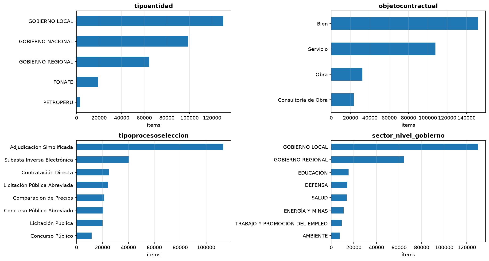

### Convocatorias: montos referenciales e ítems por mes

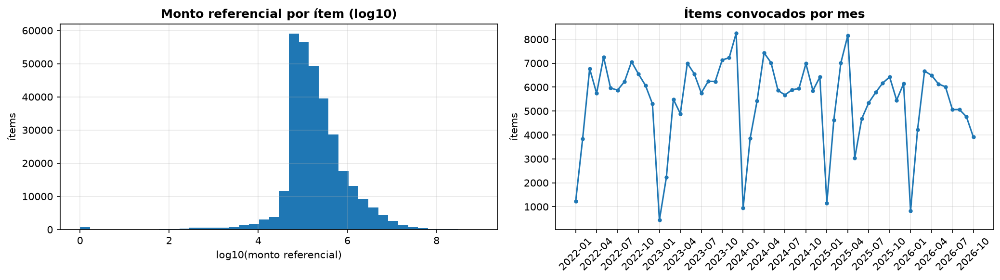

### Adjudicaciones: tipo de proveedor y montos

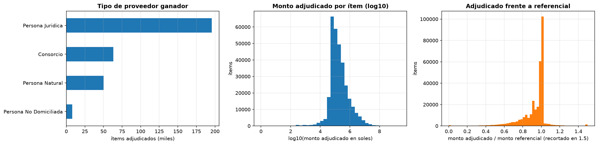

### Adjudicaciones: buenas pro por trimestre y año de archivo

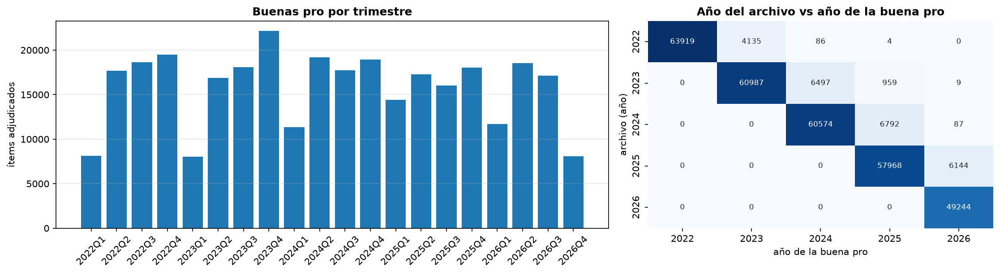

### Ofertantes: competencia y participación

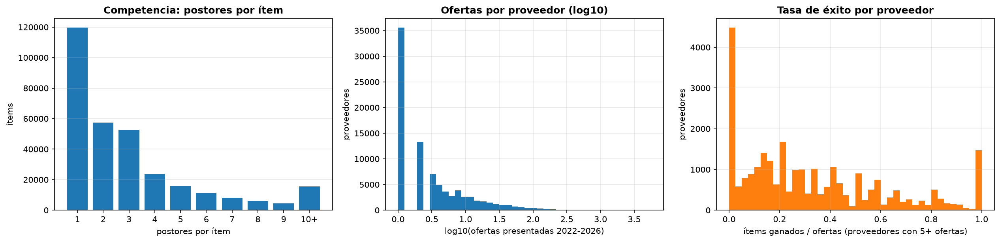

### Contratos: cobertura por tipo de proceso

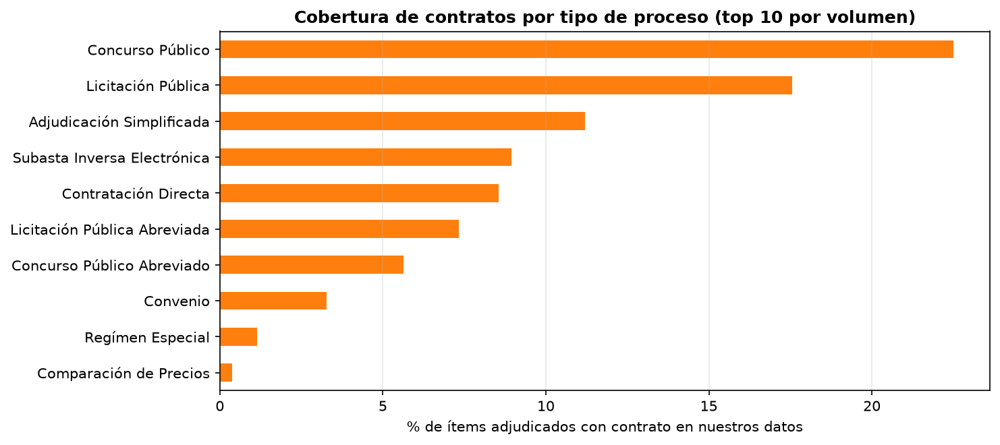

### Contratos: firmas por trimestre y días desde la buena pro

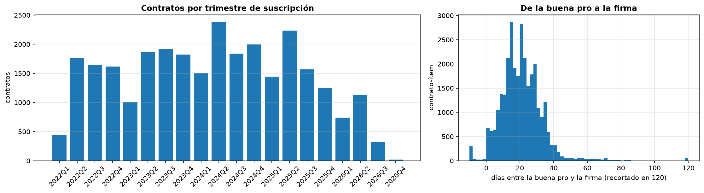

### Penalidades por año, tipo y monto

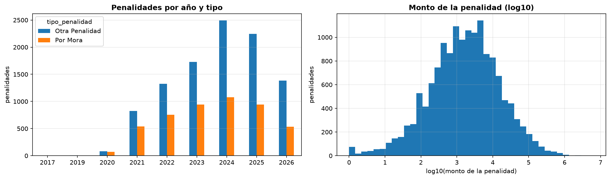

### Ampliaciones y arbitrajes por año

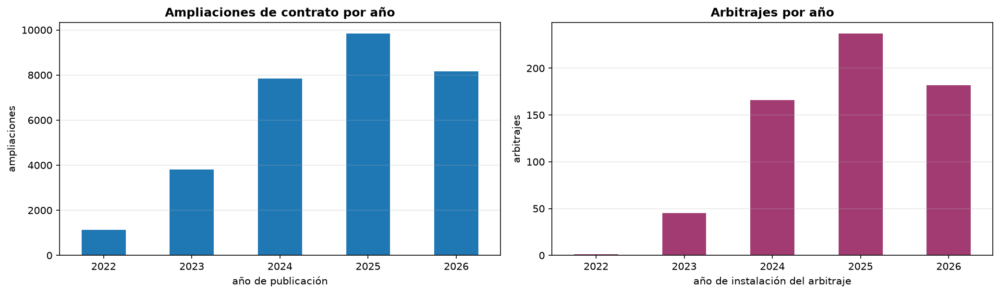

### RNP: tipo, estado y monto de multas

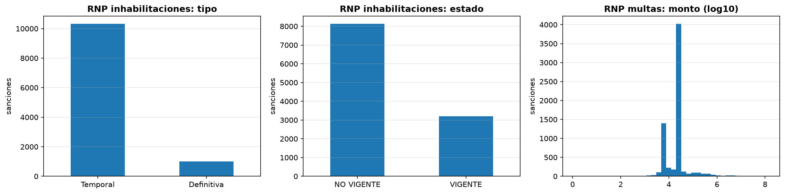

### Sanciones por año y motivo

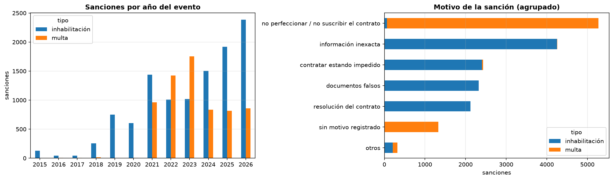

### Tasa de sanción a 12 meses por grupo

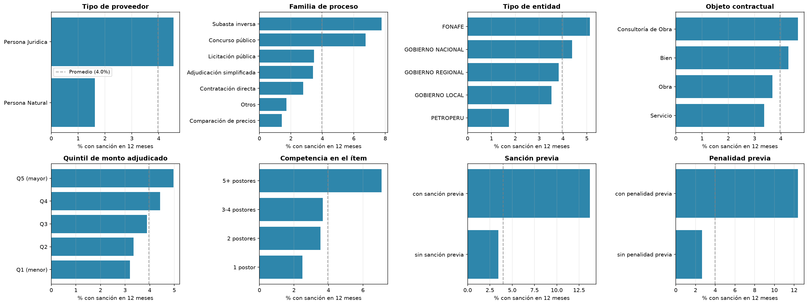

### Tiempo hasta la siguiente sanción

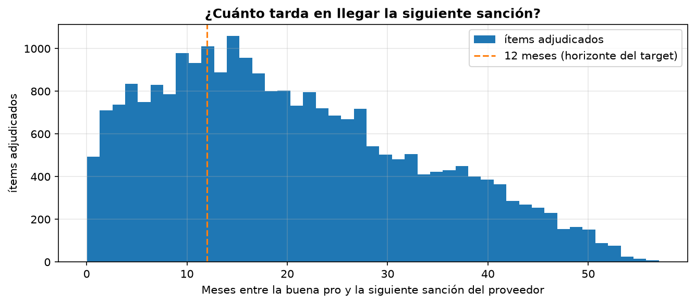
