# Resumen del modelado

Generado automáticamente por `src/evaluation.py` (o por `notebooks/03_modelos.ipynb`). Se reemplaza en cada ejecución.

## División temporal

| conjunto | cortes | filas | positivos | prevalencia_% | uso |
|---|---|---|---|---|---|
| selección | 2022-06-30, 2022-12-31, 2023-06-30, 2023-12-31 | 86093 | 1837 | 2.13 | entrenar para elegir cortes, hiperparámetros, umbral y época |
| validación | 2024-12-31 | 31200 | 594 | 1.9 | medir y elegir (target conocido recién en dic-2025) |
| entrenamiento | 2022-06-30, 2022-12-31, 2023-06-30, 2023-12-31, 2024-06-30 | 117770 | 2373 | 2.01 | entrenar los modelos finales |
| prueba | 2025-06-30 | 32738 | 795 | 2.43 | evaluación final, una sola vez |

Tabla: [`tables/division_temporal.csv`](tables/division_temporal.csv)

## Cortes de entrenamiento (elegidos en validación)

PR-AUC en validación de cada modelo con su configuración base. Opción elegida: **todos los cortes**.

| opcion | cortes | filas | positivos | Regresión logística | Árbol de decisión | KNN | MLP | promedio |
|---|---|---|---|---|---|---|---|---|
| todos los cortes | 2022-06-30, 2022-12-31, 2023-06-30, 2023-12-31 | 86093 | 1837 | 0.0846 | 0.0632 | 0.0621 | 0.0856 | 0.0739 |
| sin los cortes de 2022 | 2023-06-30, 2023-12-31 | 55695 | 1069 | 0.0852 | 0.0603 | 0.0615 | 0.0878 | 0.0737 |
| solo el último corte | 2023-12-31 | 31206 | 561 | 0.0846 | 0.0632 | 0.0628 | 0.087 | 0.0744 |

Tabla: [`tables/comparacion_de_cortes.csv`](tables/comparacion_de_cortes.csv)

## Hiperparámetros (elegidos en validación)

| Modelo | Hiperparámetros elegidos |
|---|---|
| Regresión logística | C=0.0001 |
| Árbol de decisión | max_depth=8, min_samples_leaf=100 |
| KNN | n_neighbors=1601, weights=uniform |
| MLP | capas=(16,), dropout=0.3 |

Ver todas las configuraciones probadas

| Modelo | configuracion | pr_auc_entrenamiento | pr_auc_validacion | elegida |
|---|---|---|---|---|
| Regresión logística | C=1e-05 | 0.1075 | 0.0843 | False |
| Regresión logística | C=0.0001 | 0.1144 | 0.0872 | True |
| Regresión logística | C=0.001 | 0.1136 | 0.0855 | False |
| Regresión logística | C=0.01 | 0.1131 | 0.0846 | False |
| Regresión logística | C=0.1 | 0.113 | 0.0842 | False |
| Regresión logística | C=1 | 0.1129 | 0.084 | False |
| Árbol de decisión | max_depth=3, min_samples_leaf=50 | 0.0598 | 0.0454 | False |
| Árbol de decisión | max_depth=3, min_samples_leaf=100 | 0.0603 | 0.0454 | False |
| Árbol de decisión | max_depth=3, min_samples_leaf=200 | 0.0603 | 0.0454 | False |
| Árbol de decisión | max_depth=3, min_samples_leaf=400 | 0.0593 | 0.0451 | False |
| Árbol de decisión | max_depth=3, min_samples_leaf=800 | 0.0566 | 0.0452 | False |
| Árbol de decisión | max_depth=4, min_samples_leaf=50 | 0.0805 | 0.0562 | False |
| Árbol de decisión | max_depth=4, min_samples_leaf=100 | 0.0793 | 0.0549 | False |
| Árbol de decisión | max_depth=4, min_samples_leaf=200 | 0.0787 | 0.0554 | False |
| Árbol de decisión | max_depth=4, min_samples_leaf=400 | 0.0785 | 0.0556 | False |
| Árbol de decisión | max_depth=4, min_samples_leaf=800 | 0.0704 | 0.0537 | False |
| Árbol de decisión | max_depth=6, min_samples_leaf=50 | 0.1121 | 0.062 | False |
| Árbol de decisión | max_depth=6, min_samples_leaf=100 | 0.1087 | 0.0632 | False |
| Árbol de decisión | max_depth=6, min_samples_leaf=200 | 0.103 | 0.0634 | False |
| Árbol de decisión | max_depth=6, min_samples_leaf=400 | 0.0992 | 0.0627 | False |
| Árbol de decisión | max_depth=6, min_samples_leaf=800 | 0.0837 | 0.0598 | False |
| Árbol de decisión | max_depth=8, min_samples_leaf=50 | 0.1402 | 0.0652 | False |
| Árbol de decisión | max_depth=8, min_samples_leaf=100 | 0.1337 | 0.0659 | True |
| Árbol de decisión | max_depth=8, min_samples_leaf=200 | 0.121 | 0.0652 | False |
| Árbol de decisión | max_depth=8, min_samples_leaf=400 | 0.109 | 0.0636 | False |
| Árbol de decisión | max_depth=8, min_samples_leaf=800 | 0.0866 | 0.0592 | False |
| Árbol de decisión | max_depth=10, min_samples_leaf=50 | 0.1738 | 0.0574 | False |
| Árbol de decisión | max_depth=10, min_samples_leaf=100 | 0.1545 | 0.0622 | False |
| Árbol de decisión | max_depth=10, min_samples_leaf=200 | 0.1352 | 0.0632 | False |
| Árbol de decisión | max_depth=10, min_samples_leaf=400 | 0.1122 | 0.0632 | False |
| Árbol de decisión | max_depth=10, min_samples_leaf=800 | 0.087 | 0.059 | False |
| Árbol de decisión | max_depth=12, min_samples_leaf=50 | 0.2023 | 0.0554 | False |
| Árbol de decisión | max_depth=12, min_samples_leaf=100 | 0.1643 | 0.0595 | False |
| Árbol de decisión | max_depth=12, min_samples_leaf=200 | 0.1385 | 0.0618 | False |
| Árbol de decisión | max_depth=12, min_samples_leaf=400 | 0.1126 | 0.0632 | False |
| Árbol de decisión | max_depth=12, min_samples_leaf=800 | 0.087 | 0.059 | False |
| KNN | n_neighbors=51, weights=uniform |  | 0.053 | False |
| KNN | n_neighbors=51, weights=distance |  | 0.0571 | False |
| KNN | n_neighbors=101, weights=uniform |  | 0.0621 | False |
| KNN | n_neighbors=101, weights=distance |  | 0.0645 | False |
| KNN | n_neighbors=201, weights=uniform |  | 0.0686 | False |
| KNN | n_neighbors=201, weights=distance |  | 0.0697 | False |
| KNN | n_neighbors=401, weights=uniform |  | 0.0754 | False |
| KNN | n_neighbors=401, weights=distance |  | 0.0733 | False |
| KNN | n_neighbors=801, weights=uniform |  | 0.0796 | False |
| KNN | n_neighbors=801, weights=distance |  | 0.0787 | False |
| KNN | n_neighbors=1201, weights=uniform |  | 0.0818 | False |
| KNN | n_neighbors=1201, weights=distance |  | 0.081 | False |
| KNN | n_neighbors=1601, weights=uniform |  | 0.084 | True |
| KNN | n_neighbors=1601, weights=distance |  | 0.0817 | False |
| KNN | n_neighbors=2401, weights=uniform |  | 0.0831 | False |
| KNN | n_neighbors=2401, weights=distance |  | 0.0818 | False |
| MLP | capas=(16,), dropout=0.0 | 0.1287 | 0.0902 | False |
| MLP | capas=(16,), dropout=0.3 | 0.1296 | 0.0927 | True |
| MLP | capas=(16,), dropout=0.5 | 0.1238 | 0.0917 | False |
| MLP | capas=(64, 32), dropout=0.0 | 0.1315 | 0.0896 | False |
| MLP | capas=(64, 32), dropout=0.3 | 0.1369 | 0.0899 | False |
| MLP | capas=(64, 32), dropout=0.5 | 0.1268 | 0.0897 | False |
| MLP | capas=(128, 64, 32), dropout=0.0 | 0.1305 | 0.0863 | False |
| MLP | capas=(128, 64, 32), dropout=0.3 | 0.1372 | 0.0904 | False |
| MLP | capas=(128, 64, 32), dropout=0.5 | 0.1273 | 0.0909 | False |
| MLP | capas=(256, 128, 64), dropout=0.0 | 0.1321 | 0.0885 | False |
| MLP | capas=(256, 128, 64), dropout=0.3 | 0.1344 | 0.0897 | False |
| MLP | capas=(256, 128, 64), dropout=0.5 | 0.1333 | 0.0919 | False |
| MLP | capas=(512, 256, 128), dropout=0.0 | 0.1299 | 0.087 | False |
| MLP | capas=(512, 256, 128), dropout=0.3 | 0.1212 | 0.0892 | False |
| MLP | capas=(512, 256, 128), dropout=0.5 | 0.1266 | 0.0917 | False |

Tabla: [`tables/ajuste_de_hiperparametros.csv`](tables/ajuste_de_hiperparametros.csv)

## Métricas en validación y prueba

Validación: modelos de selección. Prueba: modelos finales. El umbral se elige en validación (máximo F1) y pasa a prueba como el mismo % de alertas. Azar en prueba (prevalencia): 0.024.

| Modelo | Conjunto | PR-AUC | PR-AUC / azar | ROC-AUC | Recall top 10% | Precision top 10% | Lift top 10% | Umbral | % alertas | Precision | Recall | F1 | Brier |
|---|---|---|---|---|---|---|---|---|---|---|---|---|---|
| Regresión logística | Validación | 0.0872 | 4.5816 | 0.7919 | 0.4074 | 0.0776 | 4.0741 | 0.8882 | 1.9808 | 0.1456 | 0.1515 | 0.1485 | 0.1982 |
| Regresión logística | Prueba | 0.1154 | 4.7511 | 0.8084 | 0.4302 | 0.1045 | 4.3016 | 0.8878 | 1.9824 | 0.1741 | 0.1421 | 0.1565 | 0.1921 |
| Árbol de decisión | Validación | 0.0659 | 3.4596 | 0.7449 | 0.3754 | 0.0715 | 3.7542 | 0.838 | 5.5385 | 0.0903 | 0.2626 | 0.1344 | 0.1954 |
| Árbol de decisión | Prueba | 0.0858 | 3.5347 | 0.7611 | 0.3648 | 0.0886 | 3.6476 | 0.7733 | 7.2546 | 0.1061 | 0.317 | 0.159 | 0.1884 |
| KNN | Validación | 0.084 | 4.4134 | 0.778 | 0.399 | 0.076 | 3.9899 | 0.0662 | 3.5192 | 0.1184 | 0.2189 | 0.1537 | 0.0181 |
| KNN | Prueba | 0.1044 | 4.2979 | 0.7956 | 0.4189 | 0.1017 | 4.1884 | 0.0656 | 3.6135 | 0.1429 | 0.2126 | 0.1709 | 0.0229 |
| MLP | Validación | 0.0927 | 4.8689 | 0.7865 | 0.4007 | 0.0763 | 4.0067 | 0.8528 | 3.1538 | 0.127 | 0.2104 | 0.1584 | 0.1976 |
| MLP | Prueba | 0.1159 | 4.7712 | 0.8023 | 0.4365 | 0.106 | 4.3645 | 0.8366 | 3.1554 | 0.1597 | 0.2075 | 0.1805 | 0.1884 |

Tabla: [`results/metrics.csv`](../../metrics.csv)

## Intervalos de confianza en prueba (bootstrap)

| Modelo | Métrica | Valor | IC 95% inferior | IC 95% superior |
|---|---|---|---|---|
| Regresión logística | PR-AUC | 0.1154 | 0.1 | 0.1358 |
| Regresión logística | ROC-AUC | 0.8084 | 0.7954 | 0.8213 |
| Regresión logística | Recall top 10% | 0.4302 | 0.3985 | 0.4602 |
| Árbol de decisión | PR-AUC | 0.0858 | 0.075 | 0.0998 |
| Árbol de decisión | ROC-AUC | 0.7611 | 0.7447 | 0.7768 |
| Árbol de decisión | Recall top 10% | 0.3648 | 0.3258 | 0.3895 |
| KNN | PR-AUC | 0.1044 | 0.0904 | 0.1224 |
| KNN | ROC-AUC | 0.7956 | 0.7815 | 0.8095 |
| KNN | Recall top 10% | 0.4189 | 0.3896 | 0.4534 |
| MLP | PR-AUC | 0.1159 | 0.1 | 0.1357 |
| MLP | ROC-AUC | 0.8023 | 0.7881 | 0.8161 |
| MLP | Recall top 10% | 0.4365 | 0.4018 | 0.4674 |

Tabla: [`tables/intervalos_de_confianza_prueba.csv`](tables/intervalos_de_confianza_prueba.csv)

## Comparación con el baseline (Regresión logística)

| Modelo | Métrica | Diferencia vs baseline | IC 95% inferior | IC 95% superior | % remuestreos en que gana al baseline | Conclusión |
|---|---|---|---|---|---|---|
| Árbol de decisión | PR-AUC | -0.0295 | -0.0444 | -0.0176 | 0.0 | peor que el baseline |
| Árbol de decisión | ROC-AUC | -0.0473 | -0.0603 | -0.0343 | 0.0 | peor que el baseline |
| Árbol de decisión | Recall top 10% | -0.0654 | -0.1001 | -0.0396 | 0.0 | peor que el baseline |
| KNN | PR-AUC | -0.011 | -0.0198 | -0.0025 | 0.4 | peor que el baseline |
| KNN | ROC-AUC | -0.0128 | -0.0192 | -0.0069 | 0.0 | peor que el baseline |
| KNN | Recall top 10% | -0.0113 | -0.0327 | 0.0162 | 23.3 | sin diferencia clara |
| MLP | PR-AUC | 0.0005 | -0.0064 | 0.0077 | 53.3 | sin diferencia clara |
| MLP | ROC-AUC | -0.0061 | -0.0116 | -0.0008 | 0.9 | peor que el baseline |
| MLP | Recall top 10% | 0.0063 | -0.018 | 0.0279 | 67.5 | sin diferencia clara |

Tabla: [`tables/comparacion_con_baseline_prueba.csv`](tables/comparacion_con_baseline_prueba.csv)

## Importancia por grupo de variables (validación)

| Grupo | KNN | MLP | Regresión logística | Árbol de decisión |
|---|---|---|---|---|
| Actividad | 0.1 | -1.6 | -0.5 | 1.1 |
| Antecedentes | 27.3 | 19.3 | 16.2 | 12.4 |
| Competencia | 1.5 | 2.5 | -0.7 | 8.0 |
| Composición | 3.4 | 1.9 | 1.4 | 4.2 |
| Concentración | -0.5 | -4.0 | -2.0 | 0.0 |
| Diversificación | 12.1 | 16.8 | 11.2 | 2.1 |
| Ejecución | 19.6 | 14.2 | 14.4 | 13.8 |
| Montos | 0.6 | 2.5 | 2.0 | 7.4 |
| Participación | 11.0 | 31.3 | 20.4 | 43.6 |
| Perfil | -0.3 | 0.5 | -1.4 | 1.9 |
| Precio | 2.3 | 0.1 | 0.1 | 4.9 |

Tabla: [`tables/importancia_por_grupo.csv`](tables/importancia_por_grupo.csv)

## Detección por subgrupo (prueba, top 10%)

| Modelo | Subgrupo | Sancionados | % de todos los sancionados | Encontrados en el top 10% | % encontrado |
|---|---|---|---|---|---|
| Regresión logística | Con sanción previa | 137 | 17.2327 | 120 | 87.5912 |
| Regresión logística | Sin sanción previa | 658 | 82.7673 | 222 | 33.7386 |
| Regresión logística | Persona jurídica | 682 | 85.7862 | 312 | 45.7478 |
| Regresión logística | Persona natural | 113 | 14.2138 | 30 | 26.5487 |
| Regresión logística | Sancionado con inhabilitación | 444 | 55.8491 | 189 | 42.5676 |
| Regresión logística | Sancionado con multa | 381 | 47.9245 | 175 | 45.9318 |
| Árbol de decisión | Con sanción previa | 137 | 17.2327 | 108 | 78.8321 |
| Árbol de decisión | Sin sanción previa | 658 | 82.7673 | 182 | 27.6596 |
| Árbol de decisión | Persona jurídica | 682 | 85.7862 | 256 | 37.5367 |
| Árbol de decisión | Persona natural | 113 | 14.2138 | 34 | 30.0885 |
| Árbol de decisión | Sancionado con inhabilitación | 444 | 55.8491 | 159 | 35.8108 |
| Árbol de decisión | Sancionado con multa | 381 | 47.9245 | 148 | 38.8451 |
| KNN | Con sanción previa | 137 | 17.2327 | 124 | 90.5109 |
| KNN | Sin sanción previa | 658 | 82.7673 | 209 | 31.7629 |
| KNN | Persona jurídica | 682 | 85.7862 | 295 | 43.2551 |
| KNN | Persona natural | 113 | 14.2138 | 38 | 33.6283 |
| KNN | Sancionado con inhabilitación | 444 | 55.8491 | 187 | 42.1171 |
| KNN | Sancionado con multa | 381 | 47.9245 | 167 | 43.832 |
| MLP | Con sanción previa | 137 | 17.2327 | 127 | 92.7007 |
| MLP | Sin sanción previa | 658 | 82.7673 | 220 | 33.4347 |
| MLP | Persona jurídica | 682 | 85.7862 | 312 | 45.7478 |
| MLP | Persona natural | 113 | 14.2138 | 35 | 30.9735 |
| MLP | Sancionado con inhabilitación | 444 | 55.8491 | 190 | 42.7928 |
| MLP | Sancionado con multa | 381 | 47.9245 | 179 | 46.9816 |

Tabla: [`tables/deteccion_por_subgrupo_prueba.csv`](tables/deteccion_por_subgrupo_prueba.csv)

## Conclusión

- Mejor modelo por PR-AUC en prueba: MLP (0.116, 4.8 veces el azar). Orden: MLP (0.116) > Regresión logística (0.115) > KNN (0.104) > Árbol de decisión (0.086).
- Revisando el 10% de proveedores con más riesgo se encuentra el 44% de los futuros sancionados.
- El análisis completo está en [`results/model_comparison.txt`](../../model_comparison.txt).

## Gráficos

### Comparación de cortes de entrenamiento (validación)

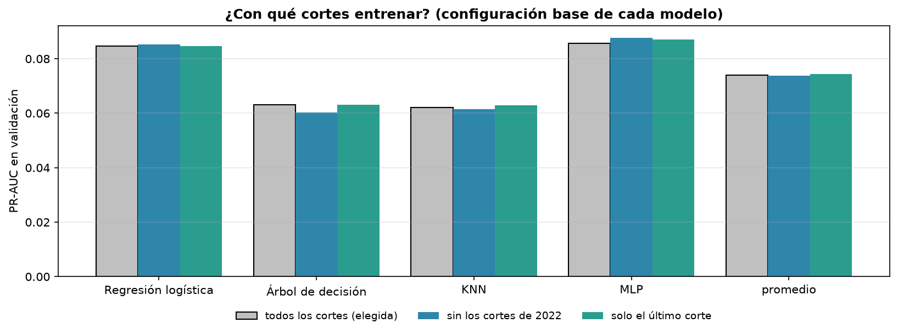

### Ajuste de hiperparámetros (validación)

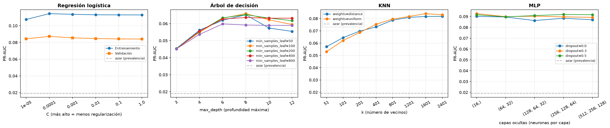

### Curvas de entrenamiento del MLP

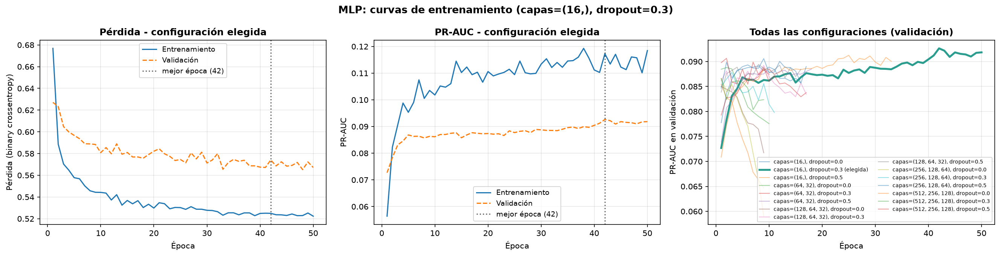

### Curvas precision-recall y ROC (prueba)

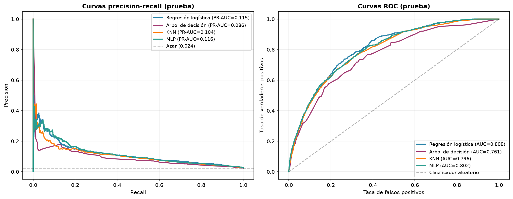

### Sancionados encontrados según el % revisado (prueba)

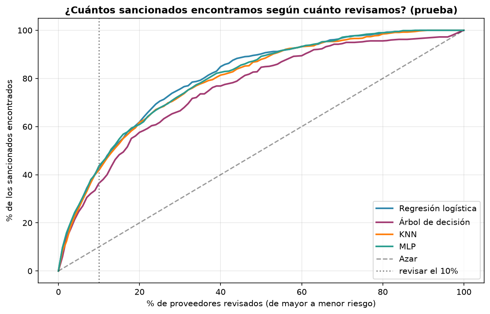

### Matrices de confusión (prueba)

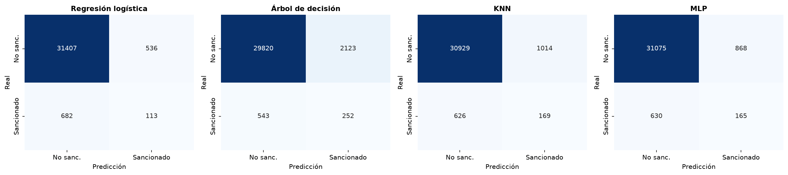

### Intervalos de confianza al 95% (prueba)

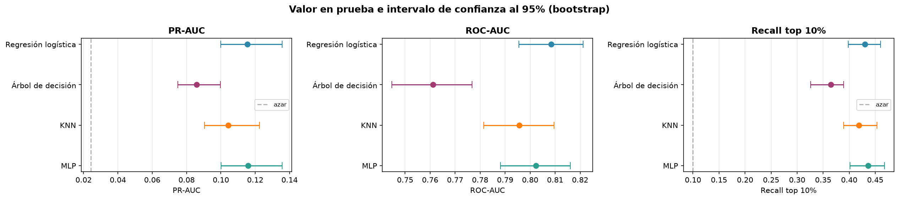

### Importancia por grupo de variables (validación)

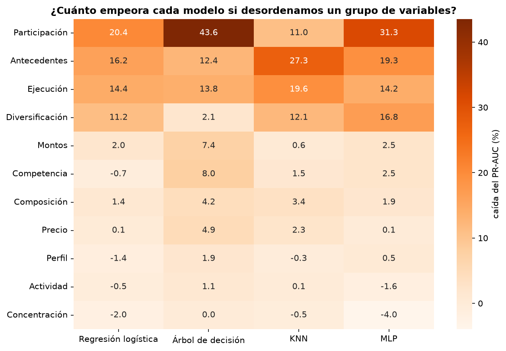

### Coeficientes de la regresión logística e importancia del árbol

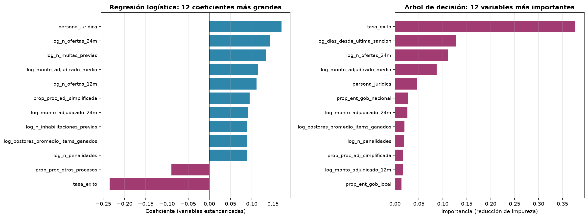

### Primeros niveles del árbol de decisión

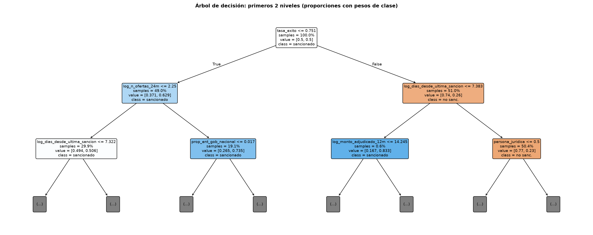

### Detección por subgrupo (prueba)

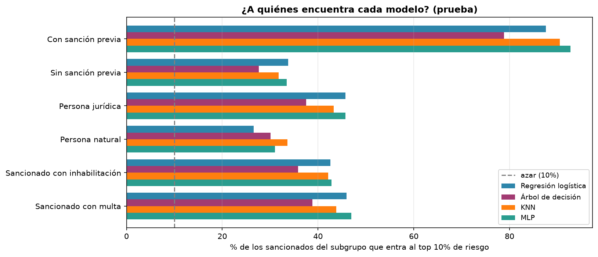
