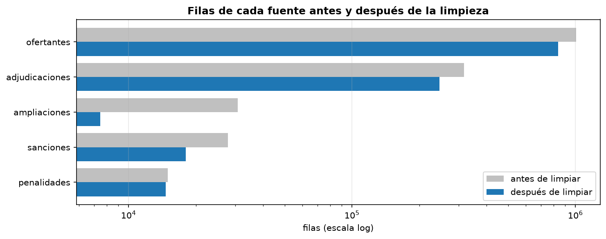
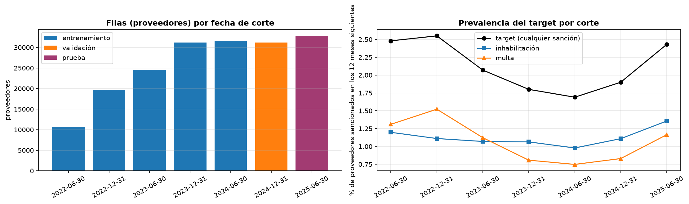
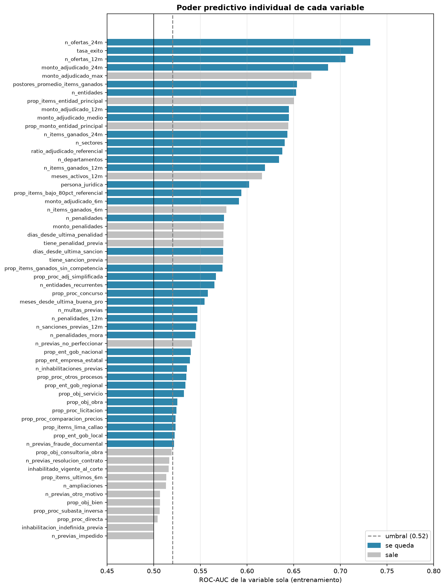
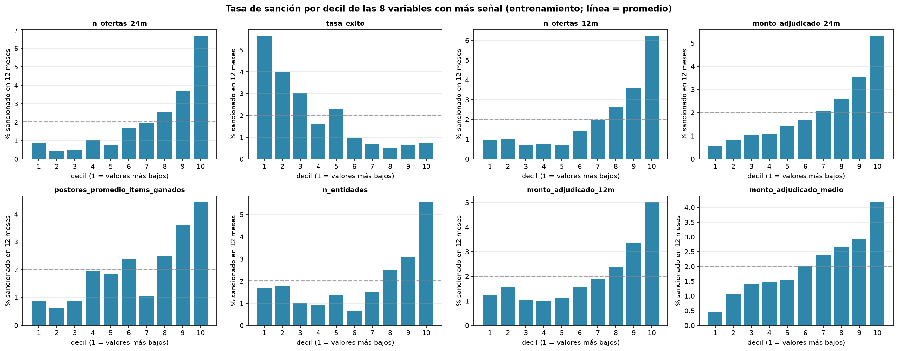
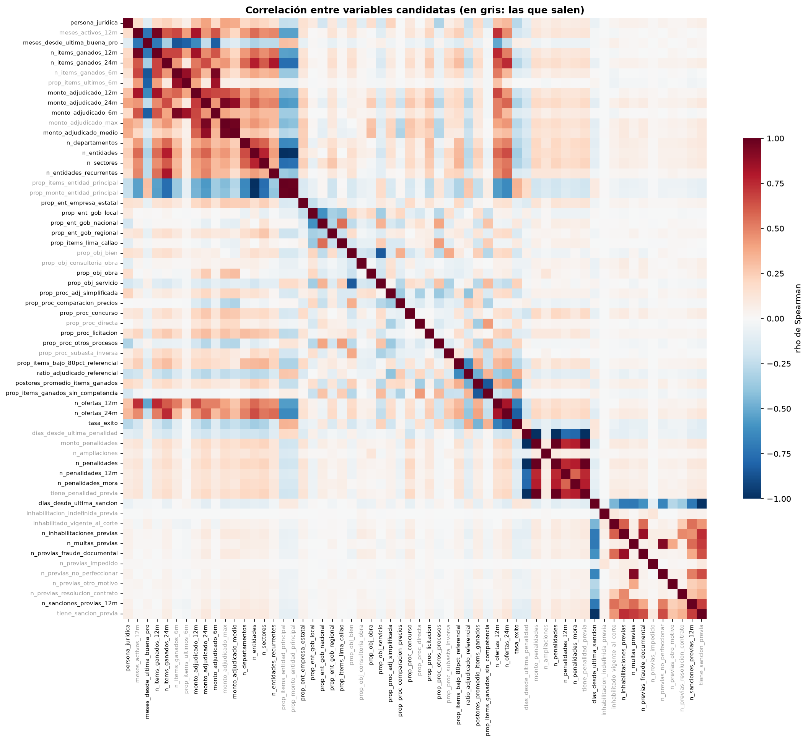
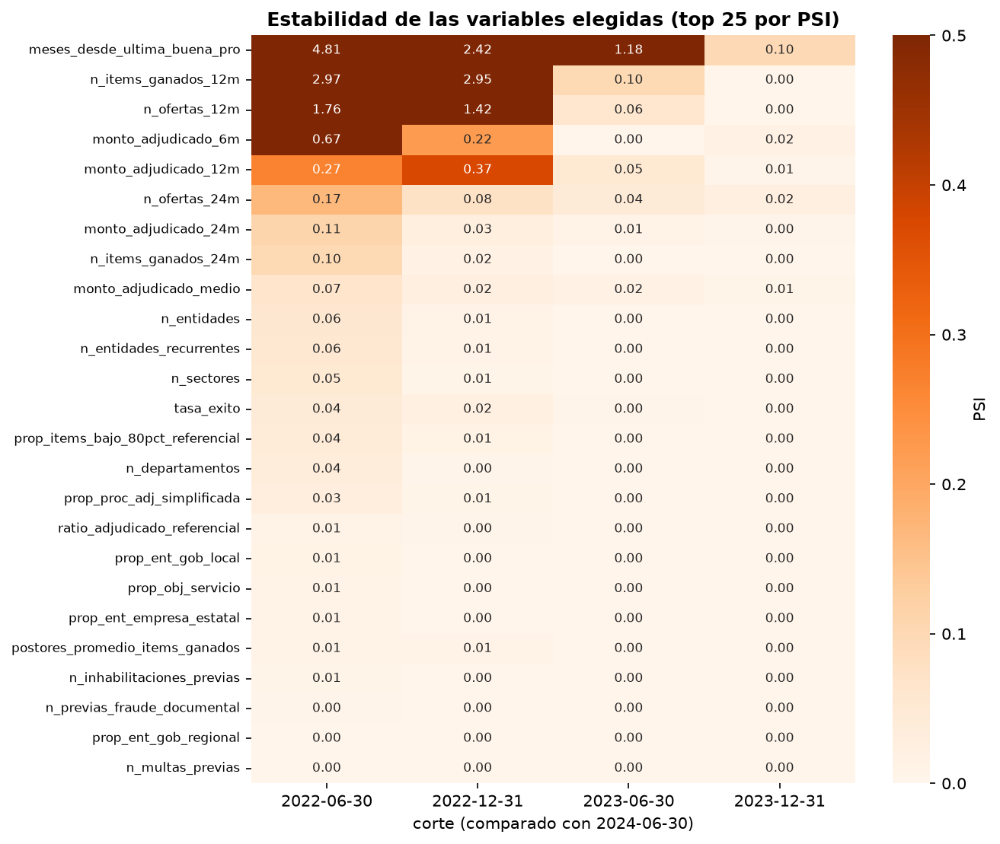

# Resumen del preprocesamiento

Generado automáticamente por `src/preprocessing.py` (o por `notebooks/02_preprocesamiento.ipynb`). Se reemplaza en cada ejecución.

## Dataset final

- Archivo: `data/processed/dataset_proveedor_corte.csv`
- Filas: 181,708 (una por proveedor y fecha de corte) | proveedores distintos: 45,095
- Columnas: 44 (2 de identificación, 3 de target y 39 predictoras)
- Población: personas naturales y jurídicas con al menos una buena pro en los 24 meses previos al corte (sin consorcios ni no domiciliados).
- Target: inhabilitación o multa en los 12 meses siguientes al corte.

## Filas y prevalencia por corte

| fecha_corte | etapa | proveedores | positivos | prevalencia_% | positivos_inhabilitacion | positivos_multa | con_sancion_previa | con_penalidad_previa | items_ganados_24m_mediana |
|---|---|---|---|---|---|---|---|---|---|
| 2022-06-30 | entrenamiento | 10687 | 265 | 2.48 | 128 | 140 | 1.4 | 3.4 | 1.0 |
| 2022-12-31 | entrenamiento | 19711 | 503 | 2.55 | 219 | 300 | 2.1 | 3.6 | 1.0 |
| 2023-06-30 | entrenamiento | 24489 | 508 | 2.07 | 262 | 275 | 3.1 | 3.8 | 1.0 |
| 2023-12-31 | entrenamiento | 31206 | 561 | 1.8 | 332 | 252 | 3.7 | 4.0 | 1.0 |
| 2024-06-30 | entrenamiento | 31677 | 536 | 1.69 | 310 | 237 | 4.1 | 4.6 | 1.0 |
| 2024-12-31 | validación | 31200 | 594 | 1.9 | 346 | 259 | 4.3 | 5.3 | 1.0 |
| 2025-06-30 | prueba | 32738 | 795 | 2.43 | 444 | 381 | 4.5 | 5.4 | 1.0 |

Tabla: [`tables/resumen_por_corte.csv`](tables/resumen_por_corte.csv)

## Limpieza

| fuente | paso | filas_antes | filas_despues | filas_quitadas | motivo |
|---|---|---|---|---|---|
| ofertantes | postor repetido en el mismo ítem | 1008414 | 1008193 | 221 | filas duplicadas |
| ofertantes | postores sin RUC (consorcios, extranjeros) | 1008193 | 836683 | 171510 | no pertenecen a la población |
| adjudicaciones | sin fecha de buena pro | 317485 | 317405 | 80 | sin fecha no sabemos desde cuándo se conoce el ítem |
| adjudicaciones | consorcios y no domiciliados | 317405 | 246034 | 71371 | solo tienen código, no RUC: sus sanciones no se pueden observar |
| adjudicaciones | mismo ganador repetido en un ítem | 246034 | 246034 | 0 | filas duplicadas |
| penalidades | filas duplicadas | 14963 | 14688 | 275 | la misma penalidad registrada dos veces |
| penalidades | fecha posterior a la descarga | 14688 | 14686 | 2 | fecha imposible |
| penalidades | sin RUC de 11 dígitos | 14686 | 14665 | 21 | no se pueden cruzar con los proveedores |
| ampliaciones | filas duplicadas | 30789 | 30440 | 349 | la misma ampliación registrada dos veces |
| ampliaciones | contrato no está en el archivo de contratos o es de un consorcio | 30440 | 7477 | 22963 | sin contrato no sabemos de qué proveedor es |
| ampliaciones | fecha posterior a la descarga | 7477 | 7464 | 13 | fecha imposible |
| sanciones | unir RNP y CONOSCE sin repetir (RUC, resolución, tipo) | 27839 | 18058 | 9781 | la misma resolución aparece en las dos fuentes |

Tabla: [`tables/registro_de_limpieza.csv`](tables/registro_de_limpieza.csv)

## Selección de variables (solo cortes de entrenamiento)

De 60 variables candidatas se quedan 39 y salen 21:
- redundante con otra variable: 10
- sin poder predictivo (ROC-AUC < 0.52): 7
- casi constante y sin poder predictivo: 4

Las 10 variables con más señal individual:

| variable | grupo | roc_auc | pr_auc_sobre_azar | sentido |
|---|---|---|---|---|
| n_ofertas_24m | Participación | 0.7319 | 2.99 | más alto, más riesgo |
| tasa_exito | Participación | 0.7138 | 2.3 | más alto, menos riesgo |
| n_ofertas_12m | Participación | 0.7055 | 2.71 | más alto, más riesgo |
| monto_adjudicado_24m | Montos | 0.6869 | 2.21 | más alto, más riesgo |
| postores_promedio_items_ganados | Competencia | 0.6535 | 1.73 | más alto, más riesgo |
| n_entidades | Diversificación | 0.6525 | 2.03 | más alto, más riesgo |
| monto_adjudicado_12m | Montos | 0.6447 | 2.04 | más alto, más riesgo |
| monto_adjudicado_medio | Montos | 0.6447 | 1.74 | más alto, más riesgo |
| n_items_ganados_24m | Actividad | 0.6431 | 1.88 | más alto, más riesgo |
| n_sectores | Diversificación | 0.6404 | 2.16 | más alto, más riesgo |

Decisión para las 60 variables candidatas

| variable | grupo | roc_auc | pr_auc_sobre_azar | sentido | decision | motivo |
|---|---|---|---|---|---|---|
| n_ofertas_24m | Participación | 0.7319 | 2.99 | más alto, más riesgo | se queda | tiene señal y no es redundante |
| tasa_exito | Participación | 0.7138 | 2.3 | más alto, menos riesgo | se queda | tiene señal y no es redundante |
| n_ofertas_12m | Participación | 0.7055 | 2.71 | más alto, más riesgo | se queda | tiene señal y no es redundante |
| monto_adjudicado_24m | Montos | 0.6869 | 2.21 | más alto, más riesgo | se queda | tiene señal y no es redundante |
| postores_promedio_items_ganados | Competencia | 0.6535 | 1.73 | más alto, más riesgo | se queda | tiene señal y no es redundante |
| n_entidades | Diversificación | 0.6525 | 2.03 | más alto, más riesgo | se queda | tiene señal y no es redundante |
| monto_adjudicado_12m | Montos | 0.6447 | 2.04 | más alto, más riesgo | se queda | tiene señal y no es redundante |
| monto_adjudicado_medio | Montos | 0.6447 | 1.74 | más alto, más riesgo | se queda | tiene señal y no es redundante |
| n_items_ganados_24m | Actividad | 0.6431 | 1.88 | más alto, más riesgo | se queda | tiene señal y no es redundante |
| n_sectores | Diversificación | 0.6404 | 2.16 | más alto, más riesgo | se queda | tiene señal y no es redundante |
| ratio_adjudicado_referencial | Precio | 0.6377 | 1.47 | más alto, menos riesgo | se queda | tiene señal y no es redundante |
| n_departamentos | Diversificación | 0.6342 | 1.96 | más alto, más riesgo | se queda | tiene señal y no es redundante |
| n_items_ganados_12m | Actividad | 0.6191 | 1.76 | más alto, más riesgo | se queda | tiene señal y no es redundante |
| persona_juridica | Perfil | 0.6022 | 1.26 | más alto, más riesgo | se queda | tiene señal y no es redundante |
| prop_items_bajo_80pct_referencial | Precio | 0.5938 | 1.25 | más alto, más riesgo | se queda | tiene señal y no es redundante |
| monto_adjudicado_6m | Montos | 0.5913 | 1.72 | más alto, más riesgo | se queda | tiene señal y no es redundante |
| n_penalidades | Ejecución | 0.5751 | 2.18 | más alto, más riesgo | se queda | tiene señal y no es redundante |
| dias_desde_ultima_sancion | Antecedentes | 0.5744 | 2.2 | más alto, menos riesgo | se queda | tiene señal y no es redundante |
| prop_items_ganados_sin_competencia | Competencia | 0.5736 | 1.14 | más alto, menos riesgo | se queda | tiene señal y no es redundante |
| prop_proc_adj_simplificada | Composición | 0.5667 | 1.1 | más alto, más riesgo | se queda | tiene señal y no es redundante |
| n_entidades_recurrentes | Concentración | 0.5649 | 1.38 | más alto, más riesgo | se queda | tiene señal y no es redundante |
| prop_proc_concurso | Composición | 0.558 | 1.3 | más alto, más riesgo | se queda | tiene señal y no es redundante |
| meses_desde_ultima_buena_pro | Actividad | 0.5544 | 1.19 | más alto, menos riesgo | se queda | tiene señal y no es redundante |
| n_penalidades_12m | Ejecución | 0.5466 | 1.88 | más alto, más riesgo | se queda | tiene señal y no es redundante |
| n_multas_previas | Antecedentes | 0.5466 | 1.8 | más alto, más riesgo | se queda | tiene señal y no es redundante |
| n_sanciones_previas_12m | Antecedentes | 0.5453 | 1.92 | más alto, más riesgo | se queda | tiene señal y no es redundante |
| n_penalidades_mora | Ejecución | 0.5446 | 1.6 | más alto, más riesgo | se queda | tiene señal y no es redundante |
| prop_ent_gob_nacional | Composición | 0.5398 | 0.99 | más alto, más riesgo | se queda | tiene señal y no es redundante |
| prop_ent_empresa_estatal | Composición | 0.5387 | 1.05 | más alto, más riesgo | se queda | tiene señal y no es redundante |
| n_inhabilitaciones_previas | Antecedentes | 0.5354 | 1.5 | más alto, más riesgo | se queda | tiene señal y no es redundante |
| prop_proc_otros_procesos | Composición | 0.5348 | 1.07 | más alto, menos riesgo | se queda | tiene señal y no es redundante |
| prop_ent_gob_regional | Composición | 0.534 | 0.99 | más alto, más riesgo | se queda | tiene señal y no es redundante |
| prop_obj_servicio | Composición | 0.5322 | 1.05 | más alto, menos riesgo | se queda | tiene señal y no es redundante |
| prop_obj_obra | Composición | 0.5252 | 1.09 | más alto, más riesgo | se queda | tiene señal y no es redundante |
| prop_proc_licitacion | Composición | 0.5243 | 1.06 | más alto, más riesgo | se queda | tiene señal y no es redundante |
| prop_proc_comparacion_precios | Composición | 0.5234 | 1.05 | más alto, menos riesgo | se queda | tiene señal y no es redundante |
| prop_items_lima_callao | Composición | 0.5232 | 0.97 | más alto, más riesgo | se queda | tiene señal y no es redundante |
| prop_ent_gob_local | Composición | 0.5223 | 1.0 | más alto, menos riesgo | se queda | tiene señal y no es redundante |
| n_previas_fraude_documental | Antecedentes | 0.5218 | 1.24 | más alto, más riesgo | se queda | tiene señal y no es redundante |
| monto_adjudicado_max | Montos | 0.6687 | 2.06 | más alto, más riesgo | sale | redundante con monto_adjudicado_24m (rho = 0.95) |
| prop_items_entidad_principal | Concentración | 0.6504 | 1.99 | más alto, menos riesgo | sale | redundante con n_entidades (rho = -0.99) |
| prop_monto_entidad_principal | Concentración | 0.6443 | 1.79 | más alto, menos riesgo | sale | redundante con n_entidades (rho = -0.99) |
| meses_activos_12m | Actividad | 0.6159 | 1.65 | más alto, más riesgo | sale | redundante con n_items_ganados_12m (rho = 0.96) |
| n_items_ganados_6m | Actividad | 0.5777 | 1.51 | más alto, más riesgo | sale | redundante con monto_adjudicado_6m (rho = 0.95) |
| monto_penalidades | Ejecución | 0.5749 | 1.93 | más alto, más riesgo | sale | redundante con n_penalidades (rho = 1.00) |
| dias_desde_ultima_penalidad | Ejecución | 0.5747 | 1.84 | más alto, menos riesgo | sale | redundante con n_penalidades (rho = -1.00) |
| tiene_penalidad_previa | Ejecución | 0.5745 | 1.68 | más alto, más riesgo | sale | redundante con n_penalidades (rho = 1.00) |
| tiene_sancion_previa | Antecedentes | 0.5742 | 1.81 | más alto, más riesgo | sale | redundante con dias_desde_ultima_sancion (rho = -0.99) |
| n_previas_no_perfeccionar | Antecedentes | 0.5408 | 1.72 | más alto, más riesgo | sale | redundante con n_multas_previas (rho = 0.92) |
| prop_obj_consultoria_obra | Composición | 0.519 | 1.07 | más alto, más riesgo | sale | sin poder predictivo (ROC-AUC < 0.52) |
| n_previas_resolucion_contrato | Antecedentes | 0.5166 | 1.35 | más alto, más riesgo | sale | casi constante y sin poder predictivo |
| inhabilitado_vigente_al_corte | Antecedentes | 0.5158 | 1.19 | más alto, más riesgo | sale | sin poder predictivo (ROC-AUC < 0.52) |
| prop_items_ultimos_6m | Actividad | 0.5135 | 0.96 | más alto, más riesgo | sale | sin poder predictivo (ROC-AUC < 0.52) |
| n_ampliaciones | Ejecución | 0.513 | 1.06 | más alto, más riesgo | sale | sin poder predictivo (ROC-AUC < 0.52) |
| prop_obj_bien | Composición | 0.5067 | 1.0 | más alto, menos riesgo | sale | sin poder predictivo (ROC-AUC < 0.52) |
| n_previas_otro_motivo | Antecedentes | 0.5067 | 1.09 | más alto, más riesgo | sale | casi constante y sin poder predictivo |
| prop_proc_subasta_inversa | Composición | 0.5062 | 0.99 | más alto, más riesgo | sale | sin poder predictivo (ROC-AUC < 0.52) |
| prop_proc_directa | Composición | 0.504 | 1.0 | más alto, menos riesgo | sale | sin poder predictivo (ROC-AUC < 0.52) |
| inhabilitacion_indefinida_previa | Antecedentes | 0.5004 | 1.01 | más alto, más riesgo | sale | casi constante y sin poder predictivo |
| n_previas_impedido | Antecedentes | 0.5003 | 1.03 | más alto, más riesgo | sale | casi constante y sin poder predictivo |

Tabla: [`tables/decisiones_de_variables.csv`](tables/decisiones_de_variables.csv)

## Diccionario de datos processed

Las 44 columnas de `data/processed/dataset_proveedor_corte.csv`.

Ver diccionario completo

| columna | uso | grupo | descripcion | regla_para_faltantes | transformacion |
|---|---|---|---|---|---|
| id_proveedor | ID | Identificación | RUC del proveedor (persona natural o jurídica). | no tiene faltantes | ninguna |
| fecha_corte | ID | Identificación | Fecha de corte: las variables usan solo información hasta esta fecha. | no tiene faltantes | ninguna |
| target | Target | Target | 1 si recibe una inhabilitación o multa en los 12 meses siguientes al corte. | no tiene faltantes | ninguna |
| y_inhabilitacion_12m | Target (componente) | Target | 1 si recibe una inhabilitación en la ventana. No usar como predictora. | no tiene faltantes | ninguna |
| y_multa_12m | Target (componente) | Target | 1 si recibe una multa en la ventana. No usar como predictora. | no tiene faltantes | ninguna |
| persona_juridica | Predictora | Perfil | 1 si el RUC es de persona jurídica (20...), 0 si es persona natural (10...). | no tiene faltantes | ninguna |
| meses_desde_ultima_buena_pro | Predictora | Actividad | Meses desde la última buena pro (como máximo 24). | no tiene faltantes | ninguna |
| log_n_items_ganados_24m | Predictora | Actividad | Ítems ganados en los últimos 24 meses. | no tiene faltantes | log1p |
| log_monto_adjudicado_24m | Predictora | Montos | Monto adjudicado en soles en los últimos 24 meses. | no tiene faltantes | log1p |
| log_monto_adjudicado_6m | Predictora | Montos | Monto adjudicado en los últimos 6 meses. | 0 si no ganó | log1p |
| log_n_items_ganados_12m | Predictora | Actividad | Ítems ganados en los últimos 12 meses. | 0 si no ganó | log1p |
| log_monto_adjudicado_12m | Predictora | Montos | Monto adjudicado en los últimos 12 meses. | 0 si no ganó | log1p |
| log_monto_adjudicado_medio | Predictora | Montos | Monto adjudicado promedio por ítem. | no tiene faltantes | log1p |
| log_n_entidades | Predictora | Diversificación | Entidades distintas con las que ganó. | no tiene faltantes | log1p |
| log_n_departamentos | Predictora | Diversificación | Departamentos distintos de los ítems ganados. | no tiene faltantes | log1p |
| log_n_sectores | Predictora | Diversificación | Sectores o niveles de gobierno distintos. | no tiene faltantes | log1p |
| log_n_entidades_recurrentes | Predictora | Concentración | Entidades con las que ganó 2 o más ítems. | no tiene faltantes | log1p |
| prop_obj_obra | Predictora | Composición | Proporción de ítems ganados de objeto obra. | no tiene faltantes | ninguna |
| prop_obj_servicio | Predictora | Composición | Proporción de ítems ganados de objeto servicio. | no tiene faltantes | ninguna |
| prop_proc_adj_simplificada | Predictora | Composición | Proporción de ítems ganados por adjudicación simplificada. | no tiene faltantes | ninguna |
| prop_proc_comparacion_precios | Predictora | Composición | Proporción de ítems ganados por comparación de precios. | no tiene faltantes | ninguna |
| prop_proc_concurso | Predictora | Composición | Proporción de ítems ganados por concurso público. | no tiene faltantes | ninguna |
| prop_proc_licitacion | Predictora | Composición | Proporción de ítems ganados por licitación pública. | no tiene faltantes | ninguna |
| prop_proc_otros_procesos | Predictora | Composición | Proporción de ítems ganados por otros. | no tiene faltantes | ninguna |
| prop_ent_empresa_estatal | Predictora | Composición | Proporción de ítems de empresas estatales (FONAFE, Petroperú). | no tiene faltantes | ninguna |
| prop_ent_gob_local | Predictora | Composición | Proporción de ítems de gobiernos locales. | no tiene faltantes | ninguna |
| prop_ent_gob_nacional | Predictora | Composición | Proporción de ítems del gobierno nacional. | no tiene faltantes | ninguna |
| prop_ent_gob_regional | Predictora | Composición | Proporción de ítems de gobiernos regionales. | no tiene faltantes | ninguna |
| prop_items_lima_callao | Predictora | Composición | Proporción de ítems en Lima o Callao. | no tiene faltantes | ninguna |
| ratio_adjudicado_referencial | Predictora | Precio | Monto adjudicado / referencial, promedio por ítem (recortado en 0-2). | 1 (sin descuento) si ningún ítem tiene referencial | ninguna |
| prop_items_bajo_80pct_referencial | Predictora | Precio | Proporción de ítems ganados por debajo del 80% del referencial. | 0 si ningún ítem tiene referencial | ninguna |
| log_postores_promedio_items_ganados | Predictora | Competencia | Postores promedio en los ítems que ganó. | ítem sin lista de postores = 1 postor | log1p |
| prop_items_ganados_sin_competencia | Predictora | Competencia | Proporción de ítems ganados con un solo postor. | ítem sin lista de postores = 1 postor | ninguna |
| log_n_ofertas_24m | Predictora | Participación | Ofertas presentadas en los últimos 24 meses. | 0 si no presentó | log1p |
| log_n_ofertas_12m | Predictora | Participación | Ofertas presentadas en los últimos 12 meses. | 0 si no presentó | log1p |
| tasa_exito | Predictora | Participación | Ítems ganados / ofertas presentadas (últimos 24 meses). | si ganó más de lo que ofertó (procesos sin postores), ofertas = ganados | ninguna |
| log_n_penalidades | Predictora | Ejecución | Penalidades aplicadas por las entidades hasta el corte. | 0 si no tiene | log1p |
| log_n_penalidades_12m | Predictora | Ejecución | Penalidades en los últimos 12 meses. | 0 si no tiene | log1p |
| log_n_penalidades_mora | Predictora | Ejecución | Penalidades por mora (retraso). | 0 si no tiene | log1p |
| log_n_inhabilitaciones_previas | Predictora | Antecedentes | Inhabilitaciones con fecha anterior o igual al corte. | 0 si no tiene | log1p |
| log_n_multas_previas | Predictora | Antecedentes | Multas con fecha anterior o igual al corte. | 0 si no tiene | log1p |
| log_n_sanciones_previas_12m | Predictora | Antecedentes | Sanciones en los últimos 12 meses. | 0 si no tiene | log1p |
| log_n_previas_fraude_documental | Predictora | Antecedentes | Sanciones previas por información inexacta o documentos falsos. | 0 si no tiene | log1p |
| log_dias_desde_ultima_sancion | Predictora | Antecedentes | Días desde la última sanción. | 1826 (tope: nunca o hace más de 5 años) | log1p |

Tabla: [`tables/diccionario_de_datos_processed.csv`](tables/diccionario_de_datos_processed.csv)

## Validaciones

| validación | resultado |
|---|---|
| una fila por (id_proveedor, fecha_corte) | OK |
| sin nulos en ninguna columna | OK |
| sin columnas constantes | OK |
| target y componentes solo 0/1 | OK |
| target = inhabilitación o multa | OK |
| solo RUC de 11 dígitos | OK |
| ventanas coherentes: 6m <= 12m <= 24m y al menos 1 ítem en 24m | OK |
| las predictoras no incluyen el target ni sus componentes | OK |
| recálculo de ítems ganados (24 meses) en 400 filas | OK |
| recálculo del target en 400 filas | OK |
| recálculo de sanciones previas en 400 filas | OK |
| recálculo de penalidades previas en 400 filas | OK |

Tabla: [`tables/validaciones.csv`](tables/validaciones.csv)

## Gráficos

### Filas antes y después de la limpieza

### Filas y prevalencia por corte

### Poder predictivo de cada variable

### Tasa de sanción por decil (variables principales)

### Correlación entre variables candidatas

### Estabilidad entre cortes de entrenamiento

